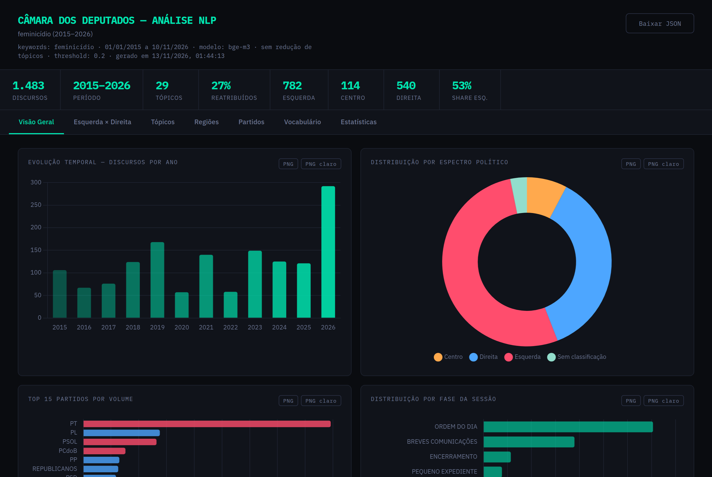
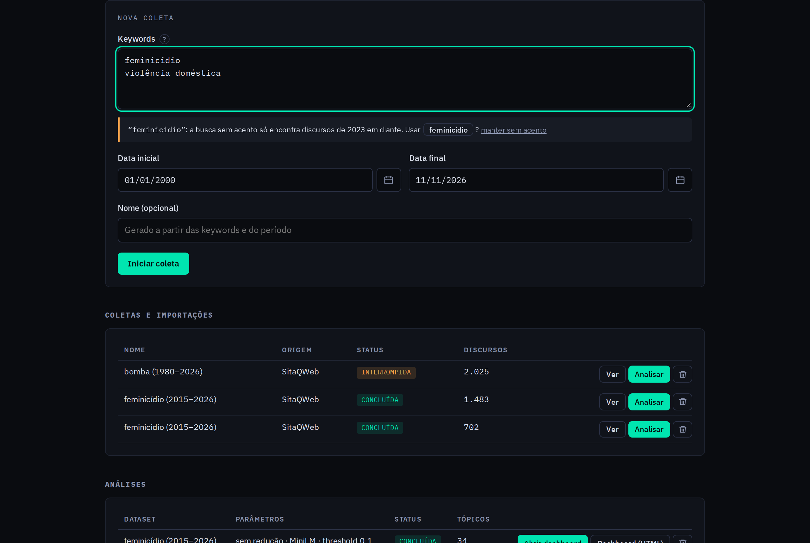
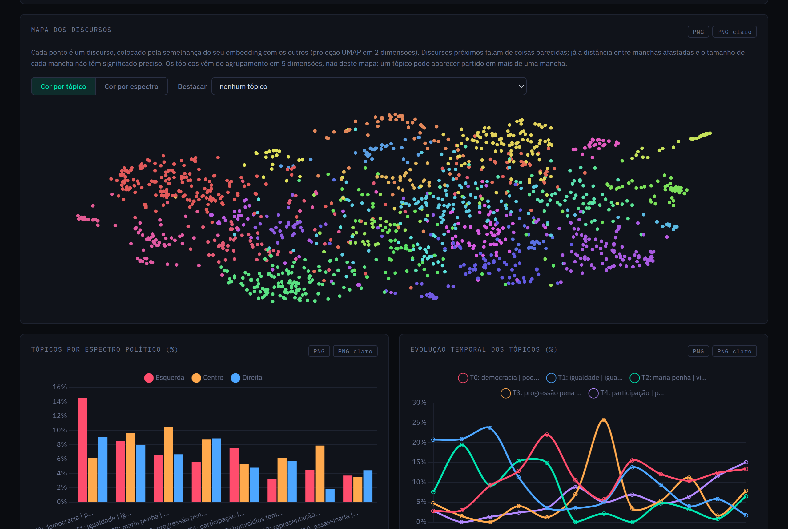

# Discursos da Câmara

Coleta discursos do Plenário da Câmara dos Deputados, encontra os tópicos com BERTopic e mostra num dashboard como eles mudam ao longo do tempo, entre partidos, espectros políticos e regiões.

> **In English:** a local web app that scrapes speeches from the Brazilian Chamber of Deputies (SitaQWeb), clusters them into topics with BERTopic, and runs trend tests (seasonal Mann-Kendall) by party, political spectrum and region. The interface and docs are in Portuguese.



O projeto nasceu de uma pesquisa sobre violência contra a mulher no discurso parlamentar, mas funciona com qualquer tema: basta mudar as keywords.

## O que ele faz

1. **Coleta** os discursos que citam as keywords num período, com orador, partido, estado, fase da sessão e texto completo, direto do [SitaQWeb](https://www.camara.leg.br/internet/sitaqweb/pesquisaDiscursos.asp). Também aceita importar um CSV.
2. **Analisa**: limpa o texto (cabeçalhos, falas da Presidência, vocativos), gera embeddings, agrupa em tópicos e dá um rótulo a cada tópico.
3. **Mostra** tudo num dashboard com sete abas: visão geral, esquerda × direita, tópicos, regiões, partidos, vocabulário e estatísticas. Os gráficos saem em PNG, e o dashboard pode ser exportado como um HTML único que abre sem o app.

## Instalação

Testado com Python 3.12. Uma GPU NVIDIA é opcional; sem ela, use o modelo MiniLM.

```bash
git clone https://github.com/khoutinho/discursos-camara.git
cd discursos-camara
python -m venv .venv
source .venv/bin/activate        # Windows: .venv\Scripts\activate
pip install -r requirements.txt
```

Na primeira análise, o modelo de embedding é baixado do Hugging Face (MiniLM: ~470 MB; bge-m3: ~2,3 GB).

## Usando o app

```bash
python -m src.app
```

Abra <http://127.0.0.1:8000>. Há três jeitos de começar:

- **Criar do zero**: keywords (uma por linha) e período. A coleta mostra o progresso e pode ser retomada se cair.
- **Já possuo CSV**: colunas `Data, Sessao, Orador, Partido, Estado, Fase, Hora, Discurso`, em UTF-8 e com acentos.
- **Já possuo dashboard_data**: abre um `dashboard_data.json` gerado antes.



> [!IMPORTANT]
> **Escreva as keywords com acento.** O índice do SitaQWeb mudou no fim de 2022: discursos até 2022 só são encontrados pela forma acentuada. "feminicídio" encontra 1.483 discursos de 2015 a 2026; "feminicidio", só 702. O app busca a forma sem acento junto, mas não consegue adivinhar a acentuada, por isso o formulário sugere a correção.

Depois da coleta, **Configurar análise** pede:

| Opção | Padrão | Para quê |
|---|---|---|
| Modelo de embedding | bge-m3 | **bge-m3** lê o discurso inteiro e dá tópicos mais específicos e estáveis; precisa de GPU (em CPU é muito lento). **MiniLM** roda sem GPU e lê o começo de cada discurso; serve para explorar. |
| Número de tópicos | sem redução | Une os tópicos mais parecidos até sobrar esse número. Sem redução os tópicos ficam mais específicos. |
| Tópicos de consenso | sim | Roda o agrupamento 15 vezes com sementes diferentes e fica com os grupos que se repetem. Tópicos bem mais estáveis; ~1 min a mais a cada 1.500 discursos. |
| Threshold do multi-label | 0,2 | Fração mínima das rodadas do consenso em que o discurso fica junto de outro tópico para recebê-lo como segundo tópico (sem consenso: probabilidade do HDBSCAN; use ~0,1). |

O formulário estima o tempo antes de rodar. Os embeddings ficam guardados: mudar o número de tópicos ou o threshold não recalcula tudo.



## API

Tudo o que o app faz passa por uma API REST. Com o app rodando, a documentação interativa de todos os endpoints fica em <http://127.0.0.1:8000/docs>.

```bash
# nova coleta
curl -X POST http://127.0.0.1:8000/api/datasets/scrape \
  -H "Content-Type: application/json" \
  -d '{"keywords": ["feminicídio"], "data_inicio": "2015-01-01", "data_fim": "2026-11-10"}'

# progresso (Server-Sent Events)
curl -N http://127.0.0.1:8000/api/datasets/1/events

# análise
curl -X POST http://127.0.0.1:8000/api/runs \
  -H "Content-Type: application/json" \
  -d '{"dataset_id": 1, "embedding_model": "bge-m3"}'

# resultados
curl -O http://127.0.0.1:8000/api/runs/1/dashboard_data.json
curl -O http://127.0.0.1:8000/api/runs/1/discursos_processados.csv
```

| Endpoint | O que faz |
|---|---|
| `GET /api/datasets` · `GET /api/datasets/{id}` | Lista coletas e importações |
| `POST /api/datasets/scrape` | Inicia uma coleta |
| `POST /api/datasets/import` | Importa um CSV (multipart, campo `file`) |
| `POST /api/datasets/{id}/resume` | Retoma uma coleta interrompida |
| `GET /api/datasets/{id}/csv` | Baixa os discursos coletados |
| `GET /api/accents?words=...` | Formas acentuadas de palavras digitadas sem acento |
| `GET /api/estimate?dataset_id=...` | Estimativa de tempo da análise |
| `POST /api/runs` · `GET /api/runs/{id}` | Inicia e acompanha uma análise |
| `GET /api/runs/{id}/events` | Progresso da análise (SSE) |
| `GET /api/methodology` | Parâmetros de cada etapa, para a seção de métodos |
| `DELETE /api/datasets/{id}` · `DELETE /api/runs/{id}` | Exclui coleta ou análise |

**Keywords sem acento na API:** a coleta é feita do jeito que foi pedida, mas a resposta de `POST /api/datasets/scrape` traz um campo `avisos` com a forma acentuada de cada palavra:

```json
"avisos": [
  {"keyword": "feminicidio", "palavra": "feminicidio", "formas": ["feminicídio"],
   "mensagem": "\"feminicidio\": a busca sem acento só encontra discursos de 2023 em diante. Usar feminicídio?"}
]
```

Palavras ambíguas trazem todas as opções em `formas` (ex.: `["país", "pais"]`).

## Linha de comando

Para rodar a análise sobre um CSV sem abrir o app:

```bash
python -m src.pipeline.run --input discursos.csv --output output/ --embedding-model bge-m3 --keywords "feminicídio"
```

A CLI faz só as tendências por contagem: ela não busca o total de discursos do Plenário nem as bancadas, então não calcula a proporção nem a proporção ÷ bancada. Para isso, use o app.

## Metodologia

| Etapa | Como |
|---|---|
| Fonte | SitaQWeb, só o Plenário (inclui Comissão Geral) |
| Limpeza | Remove cabeçalho do orador, falas da Presidência, apartes, marcações da sessão, vocativos e fórmulas de encerramento |
| Embeddings | `paraphrase-multilingual-MiniLM-L12-v2` (128 tokens) ou `BAAI/bge-m3` (discurso inteiro), sobre o texto com acentos |
| Agrupamento | UMAP (5 dimensões, cosseno) → HDBSCAN (`min_cluster_size` = máx(piso do modelo, 1% dos discursos)), 15 vezes com sementes diferentes. Os tópicos são os grupos de discursos que ficam juntos em mais da metade das rodadas (consenso por ligação média sobre a matriz de coassociação). Discursos sem consenso vão para o tópico mais próximo e ficam marcados (`Topico_reatribuido`); `Topico_certeza` é a fração das rodadas em que cada discurso ficou com o próprio tópico |
| Rótulos | c-TF-IDF só com substantivos, nomes próprios, adjetivos e particípios (spaCy); saem as palavras presentes em ≥50% dos discursos, que costumam ser as próprias keywords |
| Ideologia | Partidos classificados segundo Bolognesi, Ribeiro & Codato (2023) |
| Tendências | Mann-Kendall anual (5+ anos completos) e sazonal (Hirsch & Slack, 1984), sobre a contagem e sobre a proporção em relação ao total de discursos do Plenário no mês. Nos espectros, também a proporção ÷ fatia do espectro nas cadeiras na posse de cada legislatura (API Dados Abertos). A série começa no mês do primeiro discurso encontrado, não na data pesquisada |

A aba **Estatísticas** do dashboard e o endpoint `/api/methodology` exportam os parâmetros usados em cada análise, prontos para a seção de métodos.

### Limitações conhecidas

- **Estabilidade:** com uma rodada só, outra semente do UMAP muda o tópico de parte dos discursos (ARI ~0,6 entre sementes). O consenso de 15 rodadas resolve a maior parte disso (ARI ~0,88 entre consensos com sementes independentes), mas ~25% dos discursos (bge-m3; ~40% com MiniLM) não ficam de forma estável em nenhum tópico: veja `Topico_certeza` antes de tirar conclusões sobre discursos isolados. Alguns pares de tópicos ficam juntos em ~40% das rodadas, perto do corte; os discursos deles costumam receber o outro como segundo tópico.
- **Menções de passagem:** muitos discursos citam a keyword uma única vez, e o tópico deles reflete o assunto principal do discurso (homenagens, política local), não o tema pesquisado. Na tabela de tendência por tópico (aba Estatísticas), o switch "Mostrar menções do termo por tópico" mostra a mediana de menções e o % de discursos que citam o termo uma vez só; nenhum discurso é excluído (análises feitas antes desta opção precisam rodar de novo).
- **Antes de 2000:** o registro dos discursos no SitaQWeb era menos sistemático, e só parte deles aparece na busca. Séries que começam antes de 2000 têm um início incompleto e tendem a dar "crescente".
- **Tópicos pequenos** (15–30 discursos em uma década) quase sempre dão "sem tendência" por falta de dados.
- **Bancadas:** a proporção ÷ bancada usa as cadeiras na posse; trocas de partido durante o mandato não entram. Em 1999–2003 a API não tem o histórico dos deputados e a fatia é aproximada (inclui suplentes).

## Artigo

Artigo em preparação. A referência entra aqui quando for publicado.

Para reproduzir uma análise, guarde o CSV exportado da coleta (`GET /api/datasets/{id}/csv`) e a tabela de metodologia da análise: com os dois, a análise pode ser refeita no mesmo corpus mesmo que o SitaQWeb mude.

## Estrutura

```
src/
  scraper/    coleta no SitaQWeb e mapa de acentos (acentos_pt_BR.tsv)
  pipeline/   limpeza, embeddings, BERTopic, estatísticas e tendências
  app/        API FastAPI, banco SQLite, jobs em segundo plano e as duas telas
assets/       imagens deste README
legado/       versão anterior do projeto; em legado/extras/, os CSVs antigos e o benchmark de scraping da Fase 2
```

Os dados (banco, embeddings, resultados) ficam em `data/`, fora do git.

## Créditos e licenças

- Discursos: Câmara dos Deputados, via SitaQWeb.
- Mapa de acentos (`src/scraper/acentos_pt_BR.tsv`): gerado a partir do dicionário pt_BR do LibreOffice ([projeto VERO](https://pt-br.libreoffice.org/projetos/projeto-vero-verificador-ortografico/), LGPLv3/MPL 2.0), filtrado pela lista de frequência do [wordfreq](https://github.com/rspeer/wordfreq) (CC BY-SA 4.0). O arquivo é distribuído sob CC BY-SA 4.0.
- [BERTopic](https://maartengr.github.io/BERTopic/) (Grootendorst, 2022), [sentence-transformers](https://www.sbert.net/), [pymannkendall](https://github.com/mmhs013/pyMannKendall), [Chart.js](https://www.chartjs.org/).
